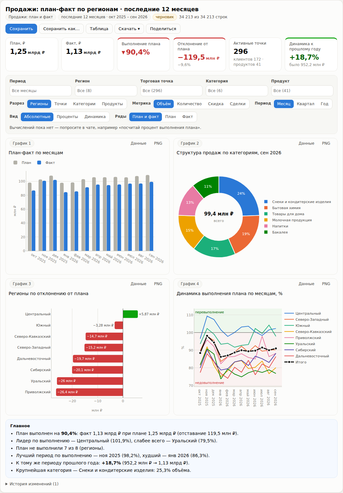

# Puzzle BI-бот

Чат-бот, который по вопросу на обычном русском языке собирает данные из базы, строит единую таблицу и выдает интерактивный дашборд прямо в чате. Сделан как решение кейса Puzzle RPA «Чат-бот с интерактивной визуализацией данных» (сентябрь 2026).

## Что умеет

- Понимает запросы вроде «собери дашборд по продажам, план и факт по регионам за последний год» и при нехватке данных задает уточняющий вопрос.
- Сам пишет SQL, собирает таблицу и добавляет вычисления по просьбе пользователя. Например, процент выполнения плана, отклонение от плана, динамику к прошлому месяцу или году, долю в общем объеме.
- Строит дашборд из четырех связанных графиков с KPI-карточками, фильтрами, переключателями разреза и текстовым резюме.
- Сохраняет дашборды с историей версий, выгружает их в HTML, Excel, CSV и PNG.
- Работает без интернета на встроенных правилах разбора русского языка. Языковую модель (GigaChat или любой OpenAI-совместимый API) можно подключить для свободных формулировок.

## Безопасность запросов

Бот подключается к базе только на чтение. Каждый SQL-запрос проверяется синтаксическим анализатором перед выполнением. Разрешен один SELECT к заранее известным таблицам, есть лимит строк и таймауты.

## Стек

Python, FastAPI, pandas, SQLite или PostgreSQL, Plotly, pytest (93 автотеста), Docker.

## Запуск

Данные кейса принадлежат организаторам и в репозиторий не входят. Чтобы запустить бот, положите CSV-файлы кейса в папку `data/` (clients, contracts, discounts, outlets, products, regions, sales, sales_plan).

На Windows достаточно дважды щелкнуть `start.bat`. Скрипт создаст окружение, установит библиотеки, соберет базу и откроет браузер на http://127.0.0.1:8000. На macOS и Linux используйте `./start.sh`, через Docker `docker compose up --build`.

Настройки лежат в `.env.example`. Скопируйте его в `.env`, если нужно подключить PostgreSQL или языковую модель.

## Структура

| Путь | Что внутри |
|---|---|
| `app/bot.py` | логика диалога и уточнений |
| `app/nlu/` | разбор запросов правилами и через языковую модель |
| `app/semantic.py` | описание данных и сборка SQL |
| `app/sql_guard.py` | проверка запросов |
| `app/calc.py` | вычисления над таблицей |
| `app/charts.py`, `app/dashboard.py` | графики, KPI, фильтры, резюме |
| `static/` | интерфейс чата |
| `tests/` | автотесты |

Подробнее в [docs/ARCHITECTURE.md](docs/ARCHITECTURE.md), сценарий демонстрации в [docs/DEMO.md](docs/DEMO.md).

## Автор

Тимофей Виноградов, [Telegram](https://t.me/Vinogradov_Timofey)
